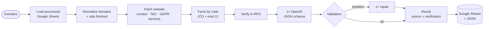

# DiscoveryDesk

🇸🇰 [Slovensky](README.md) · 🇬🇧 **English**

**From a Slovak company's domain, it prepares a verified sales brief in about a minute:** who the company is (company ID – IČO – and registered office verified in the RPO business register), what it does, 3 concrete AI automation opportunities and a polite introductory e-mail.

Solution to the **“Mini AI Discovery”** test assignment · n8n workflow · OpenAI `gpt-4o-mini` · RPO register · Google Sheets

> 📄 **Outputs for gesan.sk, bellesa.sk and serviskavovary.sk → [results/README.md](results/README.md)** (in Slovak – the brief is written for a Slovak salesperson)

---

## How it works



- **Facts by code, texts by AI.** The company ID, name and registered office are determined only by code and the official register. The AI gets nothing but verified data and the website text – it never sees the IČO, so it cannot make one up.
- **Every fact has a source.** `{ "value", "source", "verified" }` – `verified: true` only when the register confirms the IČO found on the website.
- **The workflow never crashes.** Website down, company not in the register, RPO timeout, AI error → a row with a status and an explanation, the remaining companies continue.
- **Simple to operate.** 17 nodes in a single line, one AI call per company, no paid scrapers or community nodes, all settings in one *Konfigurácia* node. A repeated run skips finished companies and the sheet always keeps one row per company.

## Results on the test websites

| Company | Status | IČO | Registered office (RPO) | Address on website | Cost |
|---|---|---|---|---|---|
| **GESAN s. r. o.** · gesan.sk | ✅ ok | 44753152 ✅ web + RPO | Výtvarná 19, 821 06 Bratislava | Dvojkrížna 28, Bratislava | $0.00212 |
| **Bellesa s.r.o.** · bellesa.sk | ✅ ok | 51241935 ✅ web + RPO | Majer 1007/293, 922 41 Drahovce | Nám. J. Murgaša 1, Piešťany | $0.00279 |
| **COFFIX s. r. o.** · serviskavovary.sk | ✅ ok | 48261068 ✅ web + RPO | Kvetná 3111/7A, 903 01 Senec | Zadunajská cesta 12, Bratislava | $0.00206 |

Example (serviskavovary.sk, a coffee-machine repair shop) – the AI first lists facts from the website and builds its ideas on them:

> **1. Automatizácia spracovania servisných formulárov** · 🟢 nízka · odhad 3–4 h týždenne pri ~20 formulároch po ~10 min
> Keď zákazník vyplní servisný formulár, AI automaticky spracuje údaje a priradí ich technikovi na opravu.
> *Prečo práve Vy:* Na webe máte servisný formulár na objednávky.
>
> *EN: Automated processing of service forms · low effort · est. 3–4 h/week at ~20 forms × ~10 min. When a customer submits the service form, AI processes the data and assigns the repair to a technician. Why you: your website has a service request form.*

Full briefs (description, findings, 3 opportunities, e-mail, sources): **[results/README.md](results/README.md)** · table: [results/vysledky.csv](results/vysledky.csv) · JSON: `results/<domain>.json`.

## Getting started

1. **Import:** n8n → *Workflows → Import from file* → [`discoverydesk.workflow.json`](discoverydesk.workflow.json)
2. **Credentials:** *OpenAI* (API key) in the *OpenAI — analýza / oprava* nodes, *Google Sheets OAuth2* in the *Načítať spracované* and *Zapísať do Google Sheets* nodes.
3. **Konfigurácia node:** put the URL of an empty Google Sheet into `google_sheet` (headers are created automatically) and the domains, separated by commas, into `domeny`.
4. **Execute workflow.** Result: one row per company in the sheet + full JSON in the *Výsledky (JSON)* node.

Tested on self-hosted n8n **2.13.4**. All settings (model, limits, timeouts, sender description) live in the *Konfigurácia* node – overview in [docs/TECHNICKE-DETAILY.md](docs/TECHNICKE-DETAILY.md) (in Slovak).

## APIs, models and costs

| Service | Used for | Price |
|---|---|---|
| Company website (direct HTTP) | text, IČO, name, address, contacts | — |
| [RPO – Slovak register of legal entities](https://api.statistics.sk/rpo/v1/) | IČO verification, official name, registered office, legal form, statutory bodies | free (CC BY 4.0) |
| [r.jina.ai](https://jina.ai/reader/) | fallback for JavaScript-rendered websites only | free |
| OpenAI `gpt-4o-mini` | description, findings, 3 opportunities, e-mail – 1 call with structured output | $0.15 / $0.60 per 1M tokens |
| Google Sheets | output table | — |

**Cost per company** (real tokens from the run, logged for every company): without a repair ~4,300 tokens ≈ $0.001; with one repair call (e.g. e-mail style) 9,300 – 13,600 tokens ≈ $0.002 – $0.003. Average on the test websites **$0.0023 per company (≈ 0.2 cents)**, 1,000 companies ≈ $1 – 3. The price is an upper bound – OpenAI's discount for cached tokens is not subtracted. The model is a single setting; `gpt-4.1-mini` writes better Slovak and still costs less than a cent per company.

## Error handling

| Status | When | What gets written |
|---|---|---|
| `ok` | everything verified | the full brief |
| `web_unreachable` | website can't be loaded (https/http, www, Jina), is behind Cloudflare or has no text | the reason; AI is not called, so it can't make things up |
| `ico_not_found_on_web` | no IČO on the website | company is looked up in RPO by name – exact match only, `verified: false` |
| `rpo_not_found` | company is not in the register | similar entities from RPO |
| `multiple_matches` | several companies with the same name in RPO | list of candidates, nothing is picked at random |
| `rpo_timeout` | RPO doesn't respond (90 s + retry) | IČO from the website marked as unverified |
| `ai_error` | OpenAI error | facts from the website and RPO, without texts |
| `invalid_domain`, `internal_error` | bad input / unexpected error | the reason; the workflow continues |

The AI output is checked by code: valid JSON, description of 2–3 sentences, exactly 3 opportunities, effort low/medium/high, e-mail of 90–120 words – and also the style the model occasionally breaks: evaluative phrases (“skvelé”, “veľmi zaujímavé” – “great”, “very interesting”), mixing “I / we” in the e-mail and generic justifications of ideas (“the website lists contacts”). On a problem, **one** repair request is sent; the 120-word limit is never exceeded.

## Tested beyond the assignment

My requirement was that the solution must work for any Slovak company, not just the three examples. During development, the AI assistant therefore ran the code through a local test harness on other types of websites as well:

| Website | Type | Result |
|---|---|---|
| profesia.sk | no IČO on the website, company was renamed | ✅ *Alma Career Slovakia s. r. o.* via its former name “Profesia, spol. s r.o.” – not the newer, unrelated *Profesia s. r. o.* |
| martinus.sk, nay.sk, websupport.sk | e-shops listing many partner IČOs | ✅ the correct operator |
| mzekon.sk | sole trader (natural person) | ✅ *Miroslava Žingorová* |
| bratislava.sk | public institution | ✅ *Hlavné mesto SR Bratislava* |
| hanuliak.sk, shipjj.sk | small companies, simple websites | ✅ ok |
| kraftnabytok.sk | brand with no IČO and no company name on the website | ⚠️ `rpo_not_found` – correct, we don't guess |
| alza.sk | Cloudflare protection | ⚠️ `web_unreachable` – AI is not called |
| non-existent domain, “toto-nie-je-domena” | bad input | ⚠️ `web_unreachable`, `invalid_domain` |

Outages were simulated too: RPO timeout, invalid OpenAI key, unavailable sheet, a website returning a server error message – the workflow always finished with the correct status.

## What changed during testing

The solution was built iteratively – every change came from a concrete finding on real data:

| Finding during tests | Change |
|---|---|
| On serviskavovary.sk all the usual paths (`/kontakt`, `/o-nas`…) return 404 – the data is on `/stranka/kontakt/` and `/stranka/vop/`; bellesa.sk has its IČO only in the GDPR page | subpages are discovered from links on the homepage, the usual paths are only a supplement |
| bellesa.sk returns the homepage with status 200 for non-existent pages (“soft 404”) | duplicate pages are discarded |
| The address on the website is not the registered office (serviskavovary: Bratislava vs. Senec, bellesa: Piešťany vs. Drahovce) | registered office always from RPO, website address separately in the `adresa_web` column |
| profesia.sk: RPO now contains a different, newer company “Profesia s. r. o.”; the real operator was renamed to Alma Career Slovakia | exact name match including the legal form, former names included (`name_changed`) |
| martinus.sk lists 24 IČOs (partners, data processors) | several candidates are verified and the one matching the website's name is chosen |
| alza.sk returns the Cloudflare page “Just a moment…”, even via Jina | bot-protection detection → `web_unreachable`, AI is not called |
| serviskavovary.sk had an outage during testing – returned only “Connect failed: Connection refused” with status 200 | website without text → `web_unreachable` with what the server returned |
| reCaptcha on the gesan.sk contact page was mistakenly detected as bot protection | more precise detection rules |
| The first AI texts were generic – e.g. online booking was suggested to bellesa.sk, which already has it | the AI first lists `zistenia` (findings) from the website and the ideas must build on them |
| E-mails had 38–50 words and felt curt | polite structure, 90–120 words, minimum-length check |
| The description sometimes had only 1 sentence (assignment: 2–3) | code counts sentences and requests a repair on failure |
| Despite the prompt, the model wrote “skvelé”, mixed “I / we” and justified ideas by “the website lists contacts” | style check in code + one repair |
| A repeated run added duplicate rows and spent tokens | finished companies are skipped, rows are written as “append or update” by domain |
| The full JSON in the sheet stretched a row to hundreds of lines | JSON is written on a single line |

## How I worked with AI

**I went through the problem and the architecture myself first.** Before the first line of code was written, I analysed the assignment and determined what the solution stands or falls on:

- **The IČO must never be invented** → it is found only by code (regex + mod 11 checksum) and verified in the RPO register; the language model never receives it.
- **Data is scattered across websites** (contact, T&C, GDPR) and websites are often down or rendered in JavaScript → several subpages, https/www variants and a fallback loader.
- **RPO is slow and returns several companies when searching by name** → timeout with retry and the rule “never pick at random” (`multiple_matches`).
- **The AI output must be machine-checkable** → structured output with a JSON schema, validation and at most one repair.
- **The salesperson must see what can be trusted** → every fact with a source and a verification flag, clear error statuses, token and cost logging.

That is where the structure of the workflow came from – the order of steps, the statuses, the sheet columns and the rules for the AI.

**I then used AI (Claude Code) as a fast colleague for the implementation:** researching the test websites and the RPO API (where the IČO is, in what format, how the search behaves), writing and debugging the Code node code, building a local test harness that runs the code in the same sandbox as n8n, and testing on more real websites.

**Decisions and reviewing the results stayed with me.** I set the requirement that the solution must work for any company, not just the three examples. The tests on other websites (e-shops, a sole trader, a public institution, a site behind Cloudflare) were therefore run by the AI assistant through the local harness – they revealed that searching RPO by name is treacherous (profesia.sk), which led to the rule of an exact match including the legal form and former names. I ran the live runs on the three test websites myself in n8n and judged the outputs through a salesperson's eyes. This led to changes: a more polite and fuller e-mail (90–120 words) and a check for already processed companies, so no tokens are wasted and no duplicates appear in the sheet. The AI also suggested making the ideas stricter – they must build on concrete facts from the website and must not propose what the company already has – and I approved it.

**Outcome:** AI saved me time mostly on writing and testing code. *What* gets solved, *how*, and what is good enough for a salesperson was my decision. The same principle applies to the solution itself: AI where it adds value (texts), code and the official register where accuracy is a must.

## Repository structure

```
discoverydesk.workflow.json   n8n workflow to import
results/                      outputs for the 3 test websites (Markdown, CSV, JSON)
src/config.json               settings → Konfigurácia node
src/nodes/*.js                Code node source (commented)
src/build-workflow.mjs        builds the workflow JSON from the code
test/run-local.mjs            local test without n8n: node test/run-local.mjs company.sk
test/collect-results.mjs      results of the last n8n run → results/
docs/TECHNICKE-DETAILY.md     settings, accuracy rules, output columns, limitations (Slovak)
```
