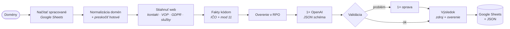

# DiscoveryDesk

🇸🇰 **Slovensky** · 🇬🇧 [English](README.en.md)

**Z domény slovenskej firmy pripraví za minútu overený podklad pre obchodníka:** kto firma je (IČO a sídlo overené v registri RPO), čo robí, 3 konkrétne príležitosti na AI automatizáciu a zdvorilý úvodný e-mail.

Riešenie testového zadania **„Mini AI Discovery“** · n8n workflow · OpenAI `gpt-4o-mini` · register RPO · Google Sheets

> 📄 **Výstupy pre gesan.sk, bellesa.sk a serviskavovary.sk → [results/README.md](results/README.md)**

---

## Ako to funguje



- **Fakty kódom, texty AI.** IČO, názov a sídlo zisťuje výhradne kód a register. AI dostane iba overené údaje a text webu – IČO vôbec nevidí, takže ho nemôže vymyslieť.
- **Každý fakt má zdroj.** `{ "value", "source", "verified" }` – `verified: true` len vtedy, keď IČO z webu potvrdí register.
- **Workflow nepadá.** Nedostupný web, firma mimo registra, timeout RPO, chyba AI → riadok so statusom a vysvetlením, ďalšie firmy idú ďalej.
- **Jednoduché na prevádzku.** 17 nód v jednej línii, jedno volanie AI na firmu, žiadne platené scrapery ani community nody, všetky nastavenia v jednej node *Konfigurácia*. Opakované spustenie preskočí hotové firmy a v tabuľke je vždy jeden riadok na firmu.

## Výsledky na testovacích weboch

| Firma | Status | IČO | Sídlo (z RPO) | Adresa na webe | Cena |
|---|---|---|---|---|---|
| **GESAN s. r. o.** · gesan.sk | ✅ ok | 44753152 ✅ web + RPO | Výtvarná 19, 821 06 Bratislava | Dvojkrížna 28, Bratislava | $0.00212 |
| **Bellesa s.r.o.** · bellesa.sk | ✅ ok | 51241935 ✅ web + RPO | Majer 1007/293, 922 41 Drahovce | Nám. J. Murgaša 1, Piešťany | $0.00279 |
| **COFFIX s. r. o.** · serviskavovary.sk | ✅ ok | 48261068 ✅ web + RPO | Kvetná 3111/7A, 903 01 Senec | Zadunajská cesta 12, Bratislava | $0.00206 |

Ukážka (serviskavovary.sk) – AI najprv vypíše fakty z webu a až na nich stavia nápady:

> **1. Automatizácia spracovania servisných formulárov** · 🟢 nízka · odhad 3–4 h týždenne pri ~20 formulároch po ~10 min
> Keď zákazník vyplní servisný formulár, AI automaticky spracuje údaje a priradí ich technikovi na opravu.
> *Prečo práve Vy:* Na webe máte servisný formulár na objednávky.

Celé podklady (popis, zistenia, 3 príležitosti, e-mail, zdroje): **[results/README.md](results/README.md)** · tabuľka: [results/vysledky.csv](results/vysledky.csv) · JSON: `results/<domena>.json`.

## Spustenie

1. **Import:** n8n → *Workflows → Import from file* → [`discoverydesk.workflow.json`](discoverydesk.workflow.json)
2. **Credentials:** *OpenAI* (API key) v nodách *OpenAI — analýza / oprava*, *Google Sheets OAuth2* v nodách *Načítať spracované* a *Zapísať do Google Sheets*.
3. **Konfigurácia:** do `google_sheet` vložte URL prázdnej Google tabuľky (hlavičky sa vytvoria samé), do `domeny` domény oddelené čiarkou.
4. **Execute workflow.** Výsledok: riadok na firmu v tabuľke + plný JSON v node *Výsledky (JSON)*.

Testované na n8n **2.13.4** self-hosted. Všetky nastavenia (model, limity, timeouty, text o odosielateľovi) sú v node *Konfigurácia* – prehľad v [docs/TECHNICKE-DETAILY.md](docs/TECHNICKE-DETAILY.md).

## API, modely a náklady

| Služba | Na čo | Cena |
|---|---|---|
| Web firmy (priame HTTP) | text, IČO, názov, adresa, kontakty | — |
| [RPO – Register právnických osôb](https://api.statistics.sk/rpo/v1/) | overenie IČO, oficiálny názov, sídlo, právna forma, štatutári | zadarmo (CC BY 4.0) |
| [r.jina.ai](https://jina.ai/reader/) | len záloha pre JavaScriptové weby | zadarmo |
| OpenAI `gpt-4o-mini` | popis, zistenia, 3 príležitosti, e-mail – 1 volanie so structured output | $0.15 / $0.60 za 1M tokenov |
| Google Sheets | výstupná tabuľka | — |

**Náklady na 1 firmu** (skutočné tokeny z behu, logujú sa pri každej firme): bez opravy ~4 300 tokenov ≈ $0.001, s jedným opravným volaním (napr. štýl e-mailu) 9 300 – 13 600 tokenov ≈ $0.002 – $0.003. Na testovacích weboch priemer **$0.0023 na firmu (≈ 0,2 centa)**, 1 000 firiem ≈ $1 – 3. Cena je horný odhad – zľava OpenAI za cache tokeny sa nezapočítava. Model sa mení jedným poľom; `gpt-4.1-mini` píše po slovensky lepšie a stále stojí menej ako cent na firmu.

## Ošetrenie chýb

| Status | Kedy | Čo sa zapíše |
|---|---|---|
| `ok` | všetko overené | celý podklad |
| `web_unreachable` | web nejde načítať (aj cez https/http, www, Jina), za Cloudflare alebo bez textu | dôvod; AI sa nevolá, aby nevymýšľala |
| `ico_not_found_on_web` | IČO na webe nie je | firma sa hľadá v RPO podľa názvu – len presná zhoda, `verified: false` |
| `rpo_not_found` | firma v registri nie je | podobné subjekty z RPO |
| `multiple_matches` | v RPO viac firiem s rovnakým názvom | zoznam kandidátov, nič sa nevyberá náhodne |
| `rpo_timeout` | RPO neodpovedá (90 s + opakovanie) | IČO z webu ako neoverené |
| `ai_error` | chyba OpenAI | fakty z webu a RPO, bez textov |
| `invalid_domain`, `internal_error` | chybný vstup / neočakávaná chyba | dôvod; workflow pokračuje |

Výstup AI kontroluje kód: platný JSON, popis 2–3 vety, presne 3 príležitosti, náročnosť nízka/stredná/vysoká, e-mail 90–120 slov – a aj štýl, ktorý model občas poruší: hodnotiace frázy („skvelé“, „veľmi zaujímavé“), miešanie „ja / my“ v e-maile a všeobecné zdôvodnenia nápadov („na webe sú kontakty“). Pri probléme ide **jedna** opravná požiadavka; limit 120 slov sa nikdy neprekročí.

## Testované aj mimo zadania

Mojou podmienkou bolo, aby riešenie fungovalo pre akúkoľvek slovenskú firmu, nielen pre tri príklady. Počas vývoja preto AI asistent spúšťal kód cez lokálny testovací stend aj na ďalších typoch webov:

| Web | Typ | Výsledok |
|---|---|---|
| profesia.sk | IČO na webe nie je, firma sa premenovala | ✅ *Alma Career Slovakia s. r. o.* podľa bývalého názvu „Profesia, spol. s r.o.“ – nie novšia firma *Profesia s. r. o.* |
| martinus.sk, nay.sk, websupport.sk | e-shopy s mnohými IČO partnerov na webe | ✅ správny prevádzkovateľ |
| mzekon.sk | živnostník (fyzická osoba) | ✅ *Miroslava Žingorová* |
| bratislava.sk | verejná inštitúcia | ✅ *Hlavné mesto SR Bratislava* |
| hanuliak.sk, shipjj.sk | malé firmy, jednoduchý web | ✅ ok |
| kraftnabytok.sk | značka bez IČO a bez názvu firmy na webe | ⚠️ `rpo_not_found` – správne, nehádame |
| alza.sk | ochrana Cloudflare | ⚠️ `web_unreachable` – AI sa nevolá |
| neexistujúca doména, „toto-nie-je-domena“ | chybný vstup | ⚠️ `web_unreachable`, `invalid_domain` |

Simulované aj výpadky: timeout RPO, chybný OpenAI kľúč, nedostupná tabuľka, web vracajúci chybovú hlášku servera – workflow vždy dobehol so správnym statusom.

## Čo sa menilo počas testovania

Riešenie vznikalo iteratívne – každá úprava vyšla z konkrétneho zistenia na reálnych dátach:

| Zistenie pri testoch | Úprava |
|---|---|
| Na serviskavovary.sk vracajú všetky typické cesty (`/kontakt`, `/o-nas`…) 404 – údaje sú na `/stranka/kontakt/` a `/stranka/vop/`; bellesa.sk má IČO len v GDPR | podstránky sa hľadajú v odkazoch z hlavnej stránky, typické cesty sú len doplnok |
| bellesa.sk vracia pre neexistujúce stránky hlavnú stránku s kódom 200 („soft 404“) | duplicitné stránky sa zahodia |
| Adresa na webe nie je sídlo (serviskavovary: Bratislava × Senec, bellesa: Piešťany × Drahovce) | sídlo vždy z RPO, adresa z webu zvlášť v stĺpci `adresa_web` |
| profesia.sk: v RPO je dnes iná, novšia firma „Profesia s. r. o.“, skutočný prevádzkovateľ sa premenoval na Alma Career Slovakia | presná zhoda názvu aj s právnou formou, vrátane bývalých názvov (`name_changed`) |
| martinus.sk uvádza 24 IČO (partneri, spracovatelia údajov) | overí sa viac kandidátov a vyberie ten, ktorý sedí s názvom webu |
| alza.sk vracia stránku Cloudflare „Just a moment…“ aj cez Jina | rozpoznanie ochrany proti robotom → `web_unreachable`, AI sa nevolá |
| serviskavovary.sk mal počas testov výpadok – s kódom 200 vracal len „Connect failed: Connection refused“ | web bez textu → `web_unreachable` s tým, čo server vrátil |
| reCaptcha na kontaktnej stránke gesan.sk sa mylne vyhodnotila ako ochrana proti robotom | presnejšie pravidlá rozpoznania |
| Prvé texty AI boli všeobecné – napr. pre bellesa.sk navrhli online rezerváciu, ktorú už má | AI najprv vypíše `zistenia` z webu a nápady na ne musia nadväzovať |
| E-maily mali 38–50 slov a pôsobili stroho | zdvorilá štruktúra, 90–120 slov, kontrola minimálnej dĺžky |
| Popis mal niekedy len 1 vetu (zadanie: 2–3) | kód počíta vety a pri chybe žiada opravu |
| Model napriek promptu písal „skvelé“, miešal „ja / my“ a zdôvodňoval nápady tým, že „na webe sú kontakty“ | kontrola štýlu kódom + jedna oprava |
| Opakované spustenie pridávalo duplicitné riadky a míňalo tokeny | preskočenie hotových firiem, zápis „append or update“ podľa domény |
| Plný JSON v tabuľke roztiahol riadok na stovky riadkov | JSON sa zapisuje v jednom riadku |

## Ako som pracoval s AI

**Problém a architektúru som si najprv prešiel sám.** Skôr než vznikol prvý riadok kódu, analyzoval som zadanie a určil, na čom riešenie stojí a padá:

- **IČO nesmie byť nikdy vymyslené** → hľadá ho iba kód (regex + kontrolný súčet mod 11) a overuje register RPO; jazykový model ho vôbec nedostane.
- **Údaje sú na weboch roztrúsené** (kontakt, VOP, GDPR) a weby bývajú nedostupné alebo v JavaScripte → viac podstránok, varianty https/www a záložné načítanie.
- **RPO je pomalé a pri hľadaní podľa názvu vracia viac firiem** → timeout s opakovaním a pravidlo „nikdy nevyberať náhodne“ (`multiple_matches`).
- **Výstup AI musí byť strojovo kontrolovateľný** → structured output s JSON schémou, validácia a najviac jedna oprava.
- **Obchodník musí vidieť, čomu môže veriť** → každý fakt so zdrojom a príznakom overenia, jasné statusy chýb, logovanie tokenov a ceny.

Z toho vznikla štruktúra workflow – poradie krokov, statusy, stĺpce tabuľky aj pravidlá pre AI.

**AI (Claude Code) som potom použil ako rýchleho kolegu na implementáciu:** na prieskum testovacích webov a RPO API (kde je IČO, v akom formáte, ako sa správa vyhľadávanie), na písanie a ladenie kódu Code nód, na lokálny testovací stend, ktorý spúšťa kód v rovnakom sandboxe ako n8n, a na testovanie na ďalších reálnych weboch.

**Rozhodnutia a kontrola výsledkov ostali na mne.** Stanovil som podmienku, že riešenie musí fungovať pre akúkoľvek firmu, nielen pre tri príklady. Testy na ďalších weboch (e-shopy, živnostník, verejná inštitúcia, web za Cloudflare) preto spúšťal AI asistent cez lokálny stend – pri nich sa ukázalo, že vyhľadávanie v RPO podľa názvu je zradné (profesia.sk), a pribudlo pravidlo presnej zhody aj s právnou formou a bývalými názvami. Ostré behy na troch testovacích weboch som spúšťal sám v n8n a výstupy som posudzoval očami obchodníka. Z toho vzišli úpravy: zdvorilejší a plnší e-mail (90–120 slov) a kontrola už spracovaných firiem, aby sa nemíňali tokeny a v tabuľke nevznikali duplicity. AI navrhla aj sprísnenie nápadov – musia vychádzať z konkrétnych faktov z webu a nesmú navrhovať to, čo firma už má – a ja som ho odsúhlasil.

**Výsledok:** AI mi ušetrila najmä čas pri písaní a testovaní kódu. O tom, *čo* sa rieši, *ako* a čo je pre obchodníka dosť dobré, som rozhodoval ja. Rovnaký princíp platí aj v samotnom riešení: AI tam, kde pridáva hodnotu (texty), kód a register tam, kde musí platiť presnosť.

## Štruktúra repozitára

```
discoverydesk.workflow.json   n8n workflow na import
results/                      výstupy pre 3 testovacie weby (Markdown, CSV, JSON)
src/config.json               nastavenia → node Konfigurácia
src/nodes/*.js                kód Code nód (komentovaný)
src/build-workflow.mjs        zostaví workflow JSON z kódu
test/run-local.mjs            lokálny test bez n8n: node test/run-local.mjs firma.sk
test/collect-results.mjs      výsledky posledného behu z n8n → results/
docs/TECHNICKE-DETAILY.md     nastavenia, pravidlá presnosti, výstupné stĺpce, obmedzenia
```
